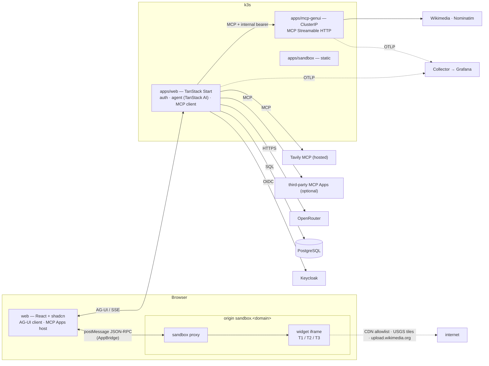
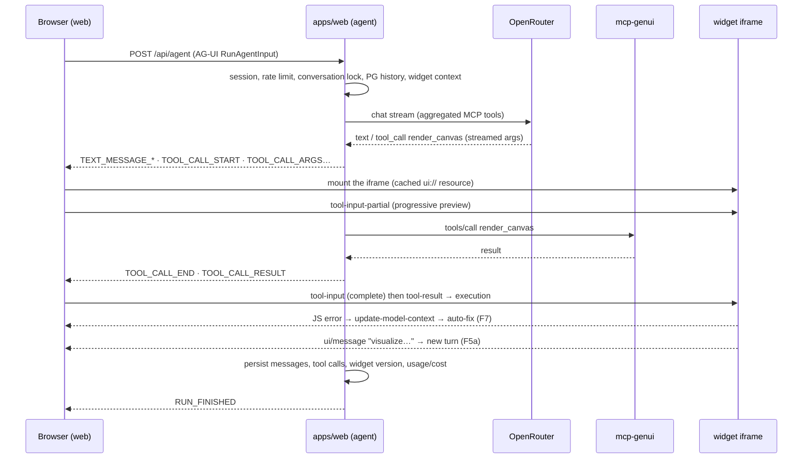

# Sinapps — Architecture & high-level functional spec

> Status: **proposal v1.1**, with the 2026-10-17 answers folded in. Date: 2026-10-17.
> Deferred topics are listed in [section 8](#8-deferred).

---

## 0. TL;DR — key decisions

| Topic | Decision | Rejected alternative (why) |
|---|---|---|
| Positioning | **Functional showcase** of generative UI, built on a clean reference stack and flow | Protocol showcase (A2UI, A2A…): out of scope |
| GenUI rendering contract | **MCP Apps** (`ui://` + sandboxed iframe + JSON-RPC over postMessage), the official extension in the MCP 2026-07-28 spec | A2UI: declarative catalog; it can't cover 3D, simulations or free-form maps, and it would duplicate MCP Apps |
| GenUI strategy | **Three-tier hybrid**: _templated_ widgets (reliable) + LLM-generated HTML _canvas_ (general purpose) + _external_ MCP Apps | 100% generated code: unreliable. 100% templated: not general purpose |
| Agent ↔ UI protocol | **AG-UI** end to end (SSE) | AI SDK → AG-UI translator: brittle (see §3.3) |
| Agent SDK | **TanStack AI** (native AG-UI, first-party OpenRouter adapter, MCP client). **Spike: GO** on 2026-10-17 (`spikes/agent-sdk/README.md`) | Fallback: AI SDK 7 end to end, **without** AG-UI |
| Web framework | **TanStack Start 1.0** (stable since 2026-10-13) | Next.js 16: adds nothing to an authenticated chat SPA, and is harder to self-host on k3s |
| LLM | **OpenRouter** (key in env), allowlist of 4 models across cost/performance tiers, default `anthropic/claude-sonnet-5.5` (§3.10) | — |
| UI | **shadcn/ui** (Radix): AI Elements, chat components, Trace, Code Block | Home-grown components |
| Chat | Faithful rendering of the ReAct loop: typed parts (text, reasoning, tools, widgets, sources, errors…) in an SDK-independent in-house format, with a renderer registry (§2.3, §3.4) | Rendering tied to SDK types |
| i18n & preferences | **FR + EN** (Paraglide JS), **light/dark/system** theme, in user settings | — |
| Auth | **Keycloak (OIDC)** through **better-auth** (`genericOAuth`). Accounts are created in Keycloak, **no signup** | — |
| Data | **PostgreSQL 18** + **Drizzle** | — |
| Web search | **The provider's hosted MCP server** (Tavily by default), swappable through configuration only | Home-grown wrapper: reinvents the wheel |
| Observability | **OpenTelemetry** (traces, metrics, logs) to the cluster's **Grafana**. LLM cost is tracked (no quota) | — |
| Admin | **No admin UI**: models and MCP servers are declared in configuration (Helm values) | Admin UI: no longer needed once quotas and sharing were dropped |
| Monorepo | **pnpm + Turborepo**: 3 deployable apps, shared `ui` and `db` packages | — |
| Quality | **Biome**, **lefthook** (pre-commit / commit-msg / pre-push), commitlint, gitleaks | ESLint + Prettier, husky |
| CI/CD | **GitHub Actions**, images and Helm chart (OCI) on **GHCR** | — |
| Deployment | **Helm** chart on **k3s** (Traefik + cert-manager), external PG and Keycloak | — |

---

## 1. Vision & principles

**Sinapps** is a multi-user conversational assistant. When it helps, it answers with an **interactive interface generated on the fly** instead of text: an illustrated explainer, a simulation, a 3D scene, a comparison table, a chart, a small tool, an animated map.

The project has two goals: demonstrate these use cases (functional showcase) and serve as a **reference implementation**, with clear flows, standard building blocks and reproducible deployment.

Inspirations: [Generative UI (Google Research)](https://generativeui.github.io/), where the LLM produces a complete web page, tool-assisted (search, images) and post-processed; the interactive visuals of Claude and ChatGPT Apps.

Principles:

1. **General first, reliable next.** The free-form canvas covers any request. Templated widgets guarantee quality for common cases.
2. **One rendering contract.** Everything beyond text goes through MCP Apps: one sandbox, one bridge, and third-party MCP Apps servers pluggable without code.
3. **One agent ↔ UI protocol.** AG-UI: the front end doesn't depend on the agent runtime.
4. **Security through isolation.** Generated code never runs in the app's origin: double iframe, separate origin, fixed CSP.
5. **Two-way loop.** The widget talks to the model (follow-up message, context, tool call), and the model evolves the widget.
6. **Stateless.** Web and MCP pods hold no state (MCP 2026-07-28 has no protocol session anymore); state lives in PG.

---

## 2. High-level functional spec

### 2.1 Personas

- **User**: account created in Keycloak by a Keycloak administrator (no signup). Manages their conversations and preferences.
- **Operator** (outside the app): configures models and MCP servers through Helm values, and tracks usage in Grafana.

### 2.2 User flows

| # | Flow | Description |
|---|---|---|
| F1 | Sign-in | Redirect to Keycloak (OIDC code + PKCE). The account is provisioned in the app on first sign-in (name, email, avatar). Optional required role (`auth.requiredRole`). Sign-out = RP-initiated logout |
| F2 | Conversations | Sidebar list: create, LLM-generated title, rename, delete, simple title search. Strictly private |
| F3 | Prompt → answer | Streaming of the text and the agent's steps (Trace: reasoning, tool calls, web sources), inline widgets. Stop button. Details in §2.3 |
| F4 | Progressive rendering | The widget frame appears as soon as the tool call starts (skeleton + title). The content builds up while the arguments stream, and scripts run once the input is complete |
| F5 | Widget → model | The widget can (a) send a follow-up message ("Visualize these gaps"), (b) update the model context without triggering a turn ("selected stop: 3"), (c) call an _app-only_ tool (e.g. next photos) |
| F6 | Iteration | "Set the default tip to 15%" → new **version** of the widget. Version navigation inside the widget frame |
| F7 | Self-repair | A JS error while rendering the canvas is reported to the model, which attempts **one** automatic fix (configurable) |
| F8 | Display | Inline, fullscreen, or side panel (MCP Apps display modes) |
| F9 | Model | Per-conversation selector over the allowlist (models that support tool calling). Default: user preference, else the global default |
| F10 | Connectors | Per-conversation toggle of optional MCP servers (e.g. web search). Core servers are always on |
| F11 | Preferences | Language **FR/EN** (default: `Accept-Language`), **light/dark/system** theme, default model. Theme and language are passed to widgets through the MCP Apps `hostContext` and to the LLM (default answer language) |

### 2.3 Chat interface (outside genUI)

Requirement: a **clean** agent chat that renders the ReAct loop (reasoning → action → observation → … → answer), tool calls and every content type legibly. This is independent of widgets: the chat must stay flawless even with no genUI at all.

**Anatomy of an assistant turn.** A turn is an ordered sequence of _parts_, displayed in the order they were produced:

```
[User] Compare these 3 plans and tell me which one is the best deal
[Assistant]
  ▾ Trace — running: expanded · done: collapsed "3 steps · 8 s"
      ◦ Reasoning          "I need up-to-date prices…"                      2.1 s
      ◦ Web search ✓       { query: "plan X price" } → 5 results            1.2 s
      ◦ Reasoning          "Plan B has the best cost per GB…"
  ▸ Widget show_table (inline)
  ▸ Text                "Plan B is the best value… [1][2]"
  ▸ Sources             (1) site-a.fr  (2) site-b.com
  [copy] [regenerate] [ⓘ model · tokens · cost · duration]
```

**Part catalog:**

| Part | Rendering | shadcn components | States |
|---|---|---|---|
| Text | Streaming Markdown (GFM, tables, code with copy, KaTeX), inline citations `[n]` | AI Elements Message / Response, Code Block | streaming → final |
| Reasoning | Expandable Trace line, with duration | AI Elements Reasoning inside Trace | streaming → done · "reasoning not displayable" when the provider encrypts it |
| Generic tool call | Trace line: server icon, readable label, arguments and result in a Code Block (JSON), duration. Optional dedicated rendering per tool (e.g. search results as a list) | Trace + Code Block | streaming arguments → running → success / error / cancelled |
| Tool call with UI | Trace line + widget in the flow | Trace + `WidgetFrame` | + widget loading / render error / auto-fix |
| Sources | Numbered list (favicon, title, domain) linked to the text citations | AI Elements Sources / Inline citation | — |
| Image | Thumbnail, lightbox, credit | AI Elements Image, Attachment | — |
| Structured question (M3, optional) | The model asks for clarification through a form (choices, fields). The answer is sent as a user message | Questionnaire | pending → answered |
| Error | Destructive callout (provider, tool, timeout, refusal) with "Retry" | Bubble `destructive` / Alert | — |
| Marker | System separator: model change, interruption, self-repair | Marker | — |

**Rendering rules:**

- **Strict order**: the display faithfully mirrors the loop, with no reordering.
- **Grouping**: consecutive "internal" parts (reasoning, tool calls without UI) form a single Trace. Text, widgets, sources and errors stay in the flow. Parallel tool calls are sibling lines of the same step.
- **Expansion**: the Trace is expanded while the run is in progress and collapses automatically at the end (preference remembered).
- **Message coming from a widget (F5a)**: user bubble with a "from ‹widget title›" badge. **Auto-fix (F7)**: marker + Trace line, no user bubble.
- **Stop**: the part in progress is frozen and marked "interrupted"; in-flight tool calls are cancelled.
- **Actions**:
  - copy (markdown);
  - regenerate the last turn;
  - edit the last user message (replaces what follows; no branches in v1);
  - details (model, tokens, cost, duration) in a popover.
- **Scroll**: Message Scroller (auto-follow, "back to bottom" button as soon as the user scrolls up).
- **Empty state**: prompt suggestions based on the demo use cases (§2.6), in FR and EN.
- **Responsive**: collapsible shadcn Sidebar. Widgets go fullscreen on mobile.
- **Accessibility**: `aria-live="polite"` on streaming text, keyboard navigation in the Trace, focus managed at the end of the run.

### 2.4 The three genUI tiers

| Tier | What | When | Guarantees |
|---|---|---|---|
| **T1 — Templated widgets** | Pre-built React/shadcn UIs served by `mcp-genui`. The LLM only provides **data** (Zod schema) | Comparison table, chart, itinerary map, media timeline/carousel | Consistent style, accessibility, no code errors |
| **T2 — Canvas** | Generic widget `ui://genui/canvas` that receives LLM-**generated HTML/CSS/JS**, with an injected kit | Everything else: simulation, 3D, explainer page, small tool, game | General purpose. Quality depends on the model, mitigated by guidelines and self-repair |
| **T3 — External MCP Apps** | Third-party MCP servers declared in configuration | Depending on their tools | The vendor's own, in the same sandbox |

**T1 catalog for v1:**

- `show_table`: typed columns, sorting, best-choice highlight, "Visualize" action (F5a).
- `show_chart`: bar / line / area / pie / radar (shadcn charts, Recharts).
- `show_map_itinerary`: MapLibre GL, USGS tiles, numbered pins, segments, credited photos, play/pause/replay, stop selection (F5b). Notice: "illustrative routes, not verified driving directions".
- `show_media_timeline`: timeline or carousel of captioned, credited images.

**T2 canvas kit** (injected by the canvas app, fixed CSP):

- shadcn CSS tokens fed by `hostContext.styles` and `hostContext.theme`: the rendering follows the host theme.
- Tailwind v4 browser build, which LLMs write reliably.
- Allowlisted libraries from a declared CDN: three.js, Chart.js, D3, MapLibre GL, KaTeX, Mermaid (pinned versions).
- `genui.*` API (wrapper around the App SDK): `genui.ask(text)`, `genui.setContext(obj)`, `genui.callTool(name, args)`, `genui.locale`, `genui.theme`.

### 2.5 Tools exposed to the model

| Tool | Server | Role |
|---|---|---|
| `show_*` (T1), `render_canvas` (T2) | `mcp-genui` | Rendering (`_meta.ui.resourceUri`) |
| `get_design_guidelines(kind)` | `mcp-genui` | Detailed guidelines loaded on demand (3d, chart, map, simulation, explainer, tool…), to keep the system prompt short |
| `search_images(query)` | `mcp-genui` | Wikimedia Commons only: URL, author, license, source link. A single image domain, so a simple CSP and no proxy |
| `geocode(place)` | `mcp-genui` | Nominatim, with a PG cache and rate limit (1 req/s, identified User-Agent) |
| Web search | **The provider's hosted MCP** (Tavily by default: `tavily-search`, `tavily-extract`) | Switching provider (Exa, etc.) = changing the configuration entry. The system prompt refers to "the web search tool" without naming it |

_App-only_ tools (`_meta.ui.visibility: ["app"]`), invisible to the model: image pagination, stop details…

### 2.6 Use case mapping

| Use case | Tier | Building blocks |
|---|---|---|
| History of timekeeping | T2 explainer page (or T1 timeline + text) | web search, `search_images`, `explainer` guideline |
| Rolling an 8 (dice probabilities) | T2 simulation + histogram | `simulation` guideline |
| Pitch / roll / yaw in 3D | T2 three.js: sliders, animated demo, reset | `3d` guideline |
| Compare offers → best deal | T1 `show_table` → "visualize" follow-up → T1 `show_chart` | F5a |
| Bill splitter | T2 small tool (total, tip, group size) | `tool` guideline, F6 |
| Coastal itinerary | T1 `show_map_itinerary` | `geocode`, `search_images`, USGS tiles |

### 2.7 Out of scope for v1

Sharing and public links, conversation branches, stream resumption after reload (v2), widget library or pinning, quotas, admin UI, signup, real-time collaboration, file upload / RAG, voice, per-user OAuth to third-party MCP servers, A2A, A2UI, exposing `mcp-genui` outside the cluster.

### 2.8 Non-functional requirements

- **Security**: generated code isolated (§3.8), no secrets on the client, `HttpOnly`/`Secure`/`SameSite=Lax` cookies, per-user rate limit (runaway protection, not a cost quota). Public repo: no committed secrets (gitleaks in pre-commit and CI).
- **Performance**: widget frame visible from `TOOL_CALL_START`, no UI blocking while streaming.
- **Cost**: tracking only. OpenRouter cost persisted per message and exposed as a metric.
- **i18n**: 100% of UI strings in FR and EN. Dates and numbers through `Intl`.
- **Accessibility**: shadcn (Radix), T1 widgets at AA level. T2 canvas on a best-effort basis (instructed in the guidelines).

---

## 3. Technical architecture

### 3.1 Overview



### 3.2 Anatomy of a turn



Key points:

- **The agent runs server-side** (`apps/web`): the OpenRouter key and MCP credentials stay on the server.
- **The MCP Apps host is our own component**, built on the official `AppBridge` from `@modelcontextprotocol/ext-apps`. The TanStack AI (`MCPAppResource`) and AI SDK (`experimental_MCPAppRenderer`) renderers document neither `tool-input-partial`, `ui/message`, update-model-context nor `hostContext`, all of which the canvas needs. `tools/call` requests issued by a widget go through `apps/web`, which checks that the tool is _app-visible_, belongs to the same server, and that the conversation belongs to the user.
- **Widget → model context**: stored in PG and injected into the next turn.

### 3.3 Agent SDK choice — analysis

| Criterion | **A. TanStack AI, native AG-UI** | **B. AI SDK 7 end to end, no AG-UI** | **C. AI SDK 7 + AG-UI translator** |
|---|---|---|---|
| Maturity | 0.6x, RC since 2026-08-21, v1 announced as "very close" | Stable 7.x (2026-06-25) | B's, plus the translator's |
| AG-UI | Official protocol, client and server | None (proprietary UI Message Stream) | Official `@ag-ui/vercel-ai-sdk` integration not published on npm and targeting AI SDK v4 (ag-ui issue #933). Third-party alternatives at v0.1 |
| OpenRouter | First-party `@tanstack/ai-openrouter` adapter | Community provider (v7 compatibility unconfirmed) or `openai-compatible` (loses native usage/cost) | Same as B |
| MCP client | `@tanstack/ai-mcp` (pool, stateless) | Stable `@ai-sdk/mcp` | Same as B |
| MCP Apps rendering | Not enough for us → in-house host | Not enough for us → in-house host | Same |
| shadcn AI Elements | Small parts → props adapter (components are copied, not a package) | Native | Native |
| Cost and risk | Low to medium cost. Risk: API still moving | Low cost. Risk: no AG-UI | **High cost**: translation layer to maintain, dual message model, silent breakage on every upgrade → brittle |

**Verdict:**

- **C is rejected.** The translator is precisely the brittle piece.
- **A is recommended.** For the genUI core, both SDKs require an in-house host anyway. They only differ on AG-UI and OpenRouter, and A wins on both. For a reference stack, AG-UI brings real decoupling: the front end only knows the protocol, and the agent runtime is replaceable (TanStack AI today; LangGraph, Mastra, Pydantic AI or another compatible runtime tomorrow) without touching the UI.
- **The RC risk is bounded**:
  - pinned versions;
  - agent code confined to `apps/web/src/server/agent`;
  - **2–3 day spike at the start of M0**, with go/no-go criteria:
    1. incremental streaming of tool arguments (`TOOL_CALL_ARGS`) through OpenRouter on the target models;
    2. calling a stateless Streamable HTTP MCP server (MCP SDK v2);
    3. OpenRouter usage and cost available in a middleware;
    4. PG persistence through the persistence middleware;
    5. AG-UI events consumable by our AppBridge host (forwarding the partial input).
  - **No-go → B**: AI SDK 7 end to end, without AG-UI, never C.

**Spike result (2026-10-17): GO.** All 5 criteria pass (details in `spikes/agent-sdk/README.md`). Tool-argument streaming depends on the upstream host behind OpenRouter, not on the SDK:

- Anthropic streams finely;
- Gemini sends everything in one block (structural);
- DeepSeek streams or not depending on the host, hence per-model `provider` routing in configuration.

**Impact on Start vs Next.js:** none, mechanically. Both SDKs are framework-agnostic: TanStack AI runs in a Next route handler, and AI SDK in a Start route. **TanStack Start stays either way**:

- it's a chat SPA behind authentication, so RSC and SEO bring nothing;
- the Vite toolchain is shared with the widget and sandbox builds;
- the Node output (Nitro) is easy to containerize on k3s, with no image optimizer or ISR cache to configure;
- Start has been stable 1.0 since 2026-10-13.

The only argument for Next would be "default path of the AI Elements examples with B", and it doesn't weigh enough.

### 3.4 Message model & chat rendering

- **In-house, SDK-independent part format.** A Zod discriminated union `MessagePart` (in `packages/db`): `text`, `reasoning`, `tool-call`, `widget`, `source`, `image`, `question`, `error`, `marker`. This is what gets persisted (`message.parts`) and rendered. A single adapter converts TanStack AI messages into this format. Had the spike led to fallback B, only this adapter would change.
- **AG-UI → parts mapping:**

  | AG-UI events | Part |
  |---|---|
  | `TEXT_MESSAGE_START` / `CONTENT` / `END` | `text` |
  | reasoning events (`REASONING_*`) | `reasoning` |
  | `TOOL_CALL_START` / `ARGS` / `END` / `RESULT` | `tool-call`, plus `widget` when the tool carries `_meta.ui.resourceUri` |
  | `STEP_STARTED` / `STEP_FINISHED` | ReAct step boundaries in the Trace |
  | `RUN_ERROR` | `error` |
  | `CUSTOM` (sources, usage/cost, `ui-resource`) | `source`, message metadata, widget resource |

- **Registry-based rendering**:
  - `PartRenderer` picks the component from the part type;
  - a second registry, `toolRenderers`, allows dedicated rendering per tool (e.g. `tavily-search` → result list), with a generic JSON fallback;
  - adding a part type or a tool renderer never requires touching the chat core.
- **Streaming Markdown**: Streamdown (used by AI Elements), which tolerates incomplete markdown while streaming. Highlighting through Code Block.
- **Persistence**: parts are persisted at the end of each step, not on every token, with a run status. A reload during a run shows the parts already persisted and an "interrupted answer" marker in v1. Stream resumption (TanStack AI durability adapters) is planned for v2.
- **Fixtures**: a `/dev/parts` page (dev only) that renders every part in each of its states from fixtures. It serves as a visual catalog and as the base for Playwright tests (screenshots).

### 3.5 Stack

| Layer | Choice | Notes |
|---|---|---|
| Runtime | Node 24 LTS, pnpm 12, strict TypeScript | |
| Monorepo | Turborepo | `dev`, `build`, `typecheck`, `test`, `--affected` |
| Web | TanStack Start 1.x, Router, Query | server functions (CRUD), `/api/agent` route (AG-UI) |
| Agent | `@tanstack/ai`, `@tanstack/ai-openrouter`, `@tanstack/ai-mcp`, `@tanstack/ai-react` / `ai-client` | pinned versions, see §3.3 |
| MCP Apps host | `@modelcontextprotocol/ext-apps` (AppBridge) + `apps/sandbox` | in-house `WidgetFrame` component |
| UI | shadcn/ui (Radix): AI Elements, Message Scroller, Message, Bubble, Attachment, Trace, Code Block, Sonner | TanStack AI messages → AI Elements props adapter |
| i18n | Paraglide JS (inlang) | compiled, typed, documented TanStack Start integration |
| Theme | `next-themes`-like (`class` attribute + `system`), value persisted in preferences | |
| T1 widgets | React + `@sinapps/ui`, single-file bundle (`vite-plugin-singlefile`) per resource | MapLibre GL, Recharts |
| MCP | `@modelcontextprotocol/server` and `client` v2 (2026-07-28 spec) | stateless Streamable HTTP |
| DB | PostgreSQL 18, Drizzle ORM + drizzle-kit | |
| Auth | better-auth + `genericOAuth` (Keycloak), TanStack Start cookies plugin, Drizzle adapter | email/password **disabled** |
| Validation | Zod 4 | |
| Tests | Vitest, Playwright (e2e against a test Keycloak) | |
| Observability | OpenTelemetry Node SDK, OTLP export | `gen_ai.*` semantic conventions |

### 3.6 Monorepo

```
sinapps/
├─ apps/
│  ├─ web/            TanStack Start: UI, auth, /api/agent (AG-UI), agent, MCP client, MCP Apps host
│  ├─ mcp-genui/      MCP server: show_* / render_canvas / get_design_guidelines / search_images / geocode,
│  │                  ui:// resources (T1 widgets + T2 canvas), guidelines (versioned markdown)
│  └─ sandbox/        MCP Apps sandbox proxy (static, separate origin)
├─ packages/
│  ├─ ui/             shared shadcn components (shadcn CLI monorepo mode), tokens, styles
│  ├─ db/             Drizzle schema, migrations, client
│  └─ tsconfig/       base TS configs
├─ infra/
│  ├─ docker-compose.yml                    postgres + keycloak (+ optional Grafana LGTM)
│  └─ keycloak/realm/sinapps-realm.json     dev realm: client, role, users alice / bob / carol (dev only)
├─ deploy/helm/sinapps/
├─ .github/workflows/  ci.yml, release.yml
├─ biome.json · lefthook.yml · commitlint.config.ts · turbo.json · pnpm-workspace.yaml
└─ sinapps.config.yaml            dev runtime config: models + MCP servers (same schema as the Helm values, path in SINAPPS_CONFIG)
```

### 3.7 Data model (high level)

```
user, session, account, verification ← better-auth (account.accountId = Keycloak sub)
user_preference(user_id, locale[fr|en], theme[light|dark|system], default_model)
conversation(id, user_id, title, model_id, enabled_servers text[], created_at, updated_at, deleted_at)
message(id, conversation_id, role, parts jsonb ← MessagePart[] (§3.4), status[streaming|done|interrupted|error],
        source[user|app|auto_fix], model_id, tokens_in, tokens_out, cost_usd, created_at)
tool_call(id, message_id, server_id, tool_name, input jsonb, result jsonb, status, duration_ms)
widget(id, conversation_id, kind[t1|canvas|external], resource_uri, title, current_version)
widget_version(id, widget_id, version, tool_call_id, input jsonb, resource_hash, created_at)
resource_snapshot(hash, server_id, uri, html, csp jsonb, permissions jsonb) ← a historical widget re-renders identically
widget_context(conversation_id, widget_id, payload jsonb, updated_at) ← update-model-context
geocode_cache(query, result jsonb, created_at)
```

Models and MCP servers are **not** stored in the database: they come from configuration (ConfigMap), validated with Zod at startup.

### 3.8 Sandbox & generated-code security

- **Double iframe**: `app.<domain>` embeds a proxy served on `sandbox.<domain>` (separate origin), which loads the widget with `sandbox="allow-scripts"`. `targetOrigin` is strict on both sides.
- **Per-resource CSP** (`_meta.ui.csp`). T2 canvas: `resourceDomains` = allowlisted CDN, `img-src` = `upload.wikimedia.org` + USGS tiles, `connectDomains` = tiles. The LLM can't widen the CSP.
- **Canvas post-processing** (inspired by the Google paper): strip `<script src>` outside the allowlist, inject the kit, capture errors (`error`, `unhandledrejection`), duration guard.
- **Tools called by a widget**: _app-visible_ only, from the same server, for a conversation owned by the user, rate limited.

### 3.9 Authentication

- **Keycloak**: in dev, the `sinapps` realm is imported when the container starts. In prod, the realm is provided by the infrastructure.
  - Client `sinapps-web`: confidential, code + PKCE, redirect `https://app.<domain>/api/auth/oauth2/callback/keycloak`, post-logout redirect.
  - `registrationAllowed: false`.
  - Optional role `sinapps-user`, checked when `AUTH_REQUIRED_ROLE` is set. Roles are read from the `roles` claim of the stored Keycloak id token (verified at sign-in), never copied into a user column: better-auth only maps provider fields that users can also edit themselves.
- **better-auth**: cookie session stored in PG. User created on first sign-in. Only the Keycloak provider is enabled (`keycloak()` preset of `genericOAuth`). `signOut()` performs RP-initiated logout natively. Access/refresh tokens are encrypted at rest.
- **apps/web → mcp-genui**: non-exposed ClusterIP service, NetworkPolicy (ingress from web pods only) and a shared static bearer (Secret). No user identity propagated: `mcp-genui` tools touch no user data.
- **Third-party MCP** (Tavily…): server-level credential, injected from a Secret (`Authorization` header).

### 3.10 LLM layer

- `OPENROUTER_API_KEY` (Secret). Allowlist and default model in configuration. At startup, models are checked against the OpenRouter models API (`supported_parameters` ⊇ `tools`): an invalid model is dropped and logged.
- Attribution headers (`HTTP-Referer`, `X-Title`). Usage and cost collected through the `onUsage` middleware, called once per model call (so once per ReAct iteration): they are summed per run, then persisted and emitted as metrics.
- System prompt: short base (role, when to use T1/T2/text, answer language = the user's language, default = UI locale), plus guidelines loaded on demand.
- **Proposed models** (OpenRouter prices as of 2026-10-17, tool calling supported, context ≥ 1M). The estimate is for a typical canvas widget (≈ 10k input tokens, 6k output):

  | Tier | OpenRouter slug | $/M in · out | ≈ $ / canvas | Intended use |
  |---|---|---|---|---|
  | Premium | `anthropic/claude-opus-5.5` | 4 · 20 | 0.16 | Demanding canvases (3D, simulations), best quality |
  | **Balanced (default)** | `anthropic/claude-sonnet-5.5` | 2 · 10 | 0.08 | Everyday use: strong at front-end code and tool calling |
  | Fast | `google/gemini-3.8-flash` | 0.825 · 4.125 | 0.03 | Fast answers, T1 widgets, lower cost |
  | Budget | `deepseek/deepseek-v4.1-flash` | 0.15 · 0.60 | 0.005 | Text and T1. Canvas to be validated (lower quality expected) |

  Costs measured by the spike for a "bill splitter" canvas: Opus $0.046, Sonnet $0.028, Gemini Flash $0.021, DeepSeek Flash $0.009. Equivalent substitute for the balanced tier: `openai/gpt-6.1-sol` (2 · 10). The allowlist stays in configuration and will evolve with the catalog.
- **Per-model configuration** (spike lessons):
  - `provider`: OpenRouter routing (`order`, `allowFallbacks`), to force a host that streams tool arguments. Example: DeepSeek → `fireworks`, `novita`, `together`.
  - `reasoning`: default reasoning level.
  - `streamsToolArgs`: hint for the UI (Gemini: `false` → skeleton + timer instead of the progressive preview).
  - `timeoutMs`: guard (DeepSeek canvas: 97 s measured).
- **Eval set**: the use cases above plus a few "trap" prompts, replayed on every prompt or model change (manual script in v1, headless render + screenshot).

### 3.11 Observability

- **Traces**: HTTP, agent run, LLM call (`gen_ai.request.model`, `gen_ai.usage.*`), MCP calls, widget rendering (optional front-end spans).
- **Metrics** (OTLP):
  - `sinapps_llm_tokens_total{model,direction}`, `sinapps_llm_cost_usd_total{model}`, `sinapps_llm_latency`;
  - `sinapps_tool_calls_total{server,tool,status}`;
  - `sinapps_widget_render_errors_total{kind}`, `sinapps_autofix_total{outcome}`.
- **No `user_id` label** (cardinality). Per-user cost is read in SQL: a `usage_by_user_day` view, usable through a read-only Grafana Postgres datasource.
- **JSON logs** on stdout, correlated by `trace_id`.
- **Chart**: OTLP endpoint as a value, Grafana dashboard shipped as a ConfigMap (`grafana_dashboard` label), can be disabled.

### 3.12 Local development

- `infra/docker-compose.yml`: `postgres:18` and `quay.io/keycloak/keycloak:26.8 start-dev --import-realm`, with healthchecks. Optional `grafana/otel-lgtm` to see traces and metrics locally.
- `pnpm dev` (turbo): `web` (:3000), `sandbox` (:3100, separate origin through the port), `mcp-genui` (:3200), in watch mode.
- Root scripts `infra:up`, `infra:down`, `infra:obs`, `db:migrate`, `db:studio`. Root `.env.example`.

### 3.13 CI/CD (GitHub Actions + GHCR, public repo)

- **`ci.yml`** (PRs and pushes to `main`):
  - `pnpm install --frozen-lockfile`;
  - `biome ci`;
  - `turbo run typecheck test build`, with the Turbo cache stored in the Actions cache;
  - `helm lint` and `kubeconform` (once the chart exists);
  - gitleaks;
  - Playwright e2e (Postgres + Keycloak services) on `main` and labeled PRs.
- **`release.yml`** (tag `v*`):
  - Buildx build of the 3 images (`turbo prune --docker`), multi-arch if needed;
  - push `ghcr.io/<owner>/sinapps-{web,mcp-genui,sandbox}`;
  - provenance attestations (`actions/attest-build-provenance`);
  - chart packaged and pushed as OCI: `oci://ghcr.io/<owner>/charts/sinapps`.
- **Minimal permissions** per job (`packages: write` only for release). Renovate for updates.

### 3.14 k3s deployment (Helm)

- **Workloads**: 3 Deployments + Services: `web`, `mcp-genui` (ClusterIP only), `sandbox` (nginx-unprivileged).
- **Ingress**: `className: traefik` (k3s default, configurable), two hosts `app.<domain>` and `sandbox.<domain>`. TLS through the `cert-manager.io/cluster-issuer` annotation (value). SSE: no buffering on the Traefik side, read timeouts sized for long runs.
- **External services**:
  - PG: `DATABASE_URL` through `existingSecret`;
  - Keycloak: `auth.issuerUrl`, `auth.clientId`, `existingSecret` for the client secret;
  - application secrets: `OPENROUTER_API_KEY`, `TAVILY_API_KEY`, `BETTER_AUTH_SECRET`, internal bearer.
- **Configuration**: `config.models[]`, `config.mcpServers[]`, `config.cdnAllowlist[]` → ConfigMap.
- **Migrations**: `pre-install,pre-upgrade` hook Job (web image).
- **Hardening**: non-root pods, `readOnlyRootFilesystem`, `/healthz` and `/readyz` probes, PDB, NetworkPolicy (natively supported by k3s), optional HPA on web.

### 3.15 Quality & conventions

- **Biome**: root `biome.json` (formatter, linter, import sorting). `biome ci` in CI.
- **lefthook**:
  - `pre-commit`: `biome check --write` on staged files (fixes re-staged automatically) and `gitleaks git --pre-commit --staged` (skipped locally if the binary is missing; enforced in CI);
  - `commit-msg`: commitlint (Conventional Commits);
  - `pre-push`: `turbo run typecheck test --affected`.
- Strict TS with `noUncheckedIndexedAccess`. Vitest per package, Playwright on `web`.

---

## 4. Milestones

| Milestone | Content | Exit demo |
|---|---|---|
| **M0 — Foundation** | **SDK spike (go/no-go)**, monorepo, Biome, lefthook, CI, PG + Keycloak compose, better-auth, shadcn layout, preferences (language, theme), conversation CRUD, AG-UI chat through OpenRouter, **complete chat UI** (§2.3: text, reasoning, generic tool, error and marker parts; Trace; actions; `/dev/parts` page), basic OTel | alice signs in, a legible multi-tool ReAct turn on the 4 models, FR/EN, traces in local Grafana |
| **M1 — MCP Apps host** | `sandbox`, minimal `mcp-genui`, `WidgetFrame` on AppBridge, widget and snapshot persistence, historical re-rendering, display modes | Interactive "hello" widget replayable after reload |
| **M2 — T2 canvas** | `render_canvas`, kit, partial streaming, guidelines, auto-fix, versions (F6) | 3D pitch/roll/yaw, dice, iterated bill splitter |
| **M3 — T1 widgets + tools** | table, chart, itinerary map, timeline, `search_images`, `geocode`, Tavily MCP (`source` parts, dedicated result rendering), F5 loop, structured question (optional) | Comparison → chart, coastal itinerary, history of timekeeping |
| **M4 — Production** | Dockerfiles, `release.yml`, Helm chart, NetworkPolicy, Grafana dashboard, e2e, evals | Deployed on the target k3s |

---

## 5. Risks

| Risk | Mitigation |
|---|---|
| TanStack AI pre-1.0 | Go/no-go spike, pinned versions, confined agent code, fallback B defined |
| Canvas quality varies by model | T1 for common cases, guidelines, auto-fix, evals, a default model strong at code |
| Uneven tool-argument streaming across OpenRouter hosts | Spike criterion. Per-model `provider` routing. Graceful degradation: skeleton, then render on the complete input |
| Cost (generated HTML = many output tokens) | Tracking and dashboard. Canvas patch tool in v2 rather than full regeneration |
| CSP too strict for some requests | Data fetched by server-side tools and passed to the widget, rather than fetched from the widget. Allowlist in configuration |
| Image licenses and credits | Wikimedia Commons only, author and license returned, credit always displayed |
| Dependency on a third-party hosted search MCP | Swappable through configuration. Optional per-conversation connector |

---

## 6. Not retained

- **CopilotKit**: reference for AG-UI + MCP Apps, but its own runtime and components overlap with shadcn and our agent.
- **A2UI, A2A**: out of scope (functional showcase, no agent-to-agent need).
- **AI SDK → AG-UI translator**: see §3.3.
- **Image proxy, Openverse**: replaced by Wikimedia only (one domain, simple CSP).

---

## 7. Decisions made (2026-10-17)

1. A functional showcase on a reference stack and flow, not a protocol showcase → no A2UI.
2. SDK: TanStack AI, confirmed by the spike (§3.3). Start kept either way.
3. Costs: tracking only, with OTel to the cluster's Grafana.
4. No sharing.
5. No widget library.
6. FR + EN, with language and theme (light/dark/system) in user preferences.
7. Web search through a dedicated provider, plugged in as a swappable MCP server.
8. GitHub Actions + GHCR (public repo), k3s with ingress and cert-manager.
9. Users created in Keycloak, no signup.
10. `mcp-genui` not exposed.
11. Web search: Tavily (hosted MCP).
12. Models: 4 cost/performance tiers (§3.10), no mandated model.
13. The chat itself (ReAct loop, tool calls, typed parts) is a first-class requirement, independent of genUI (§2.3, §3.4).
14. All project artifacts (docs, code, comments, commits) are written in English.

## 8. Deferred

To revisit once there is something to deploy (M4):

- Deployment trigger: manual `helm upgrade`, CI-triggered, or GitOps.
- k3s node architecture (amd64, arm64 or mixed), which decides the multi-arch build.
- The cluster's OTLP endpoint and Grafana stack composition (Tempo, Loki, Prometheus/Mimir).
